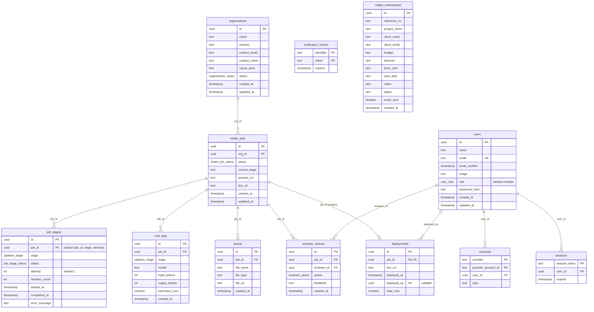

# Database schema

> **Keep this up to date:** update this diagram whenever the schema in `src/db/schema/` changes.

Source of truth is the Drizzle schema in [`schema/`](./schema). Migrations live in [`migrations/`](./migrations).

## Entity relationship diagram

OAuth token columns on `accounts` (`refresh_token`, `access_token`, `expires_at`, `token_type`, `scope`, `id_token`, `session_state`) are left out to keep the diagram readable.

`intake_submissions` and `verification_tokens` have no foreign keys.

## View: `project_metrics`

Mermaid ER diagrams can't draw views, so it's described here. Defined in [`schema/project-metrics.ts`](./schema/project-metrics.ts). One row per intake job, used by the App Factory dashboard cards.

**Reads from:**

| Table | Columns |
| --- | --- |
| `intake_jobs` | `id`, `org_id`, `status`, `created_at`, `updated_at` |
| `organizations` | `id`, `name` |
| `job_stages` | `job_id`, `stage`, `status`, `attempt`, `iteration_count`, `started_at` (only rows where `started_at` is set) |
| `cost_logs` | `job_id`, `input_tokens`, `output_tokens`, `estimated_cost` |
| `pipeline_stage` enum | value order (for stage comparison) and value count (denominator of `percent_done`) |

**Returns:** `job_id`, `org_id`, `org_name`, `status`, `current_stage`, `stages_completed`, `percent_done`, `agents_used`, `rerun_count`, `max_iteration_count`, `input_tokens`, `output_tokens`, `total_tokens`, `cost_usd`, `created_at`, `updated_at`.

Note that `current_stage` here comes from the most recently started `job_stages` row, not from `intake_jobs.current_stage`.

## Enums

**`pipeline_stage`** (in pipeline order; `project_metrics` relies on this order)
`INTAKE` → `DESIGN` → `CODE_GENERATION` → `CONTENT` → `SEO` → `APPROVAL_GATE` → `DEPLOYMENT`

**`intake_job_status`**
`queued`, `in_progress`, `awaiting_review`, `approved`, `deployed`, `failed`

**`job_stage_status`**
`pending`, `running`, `completed`, `failed`

**`reviewer_action`**
`approved`, `rejected`

**`organization_status`**
`prospect`, `applicant`, `active`, `alumni`

**`user_role`**
`admin`, `reviewer`, `member`
